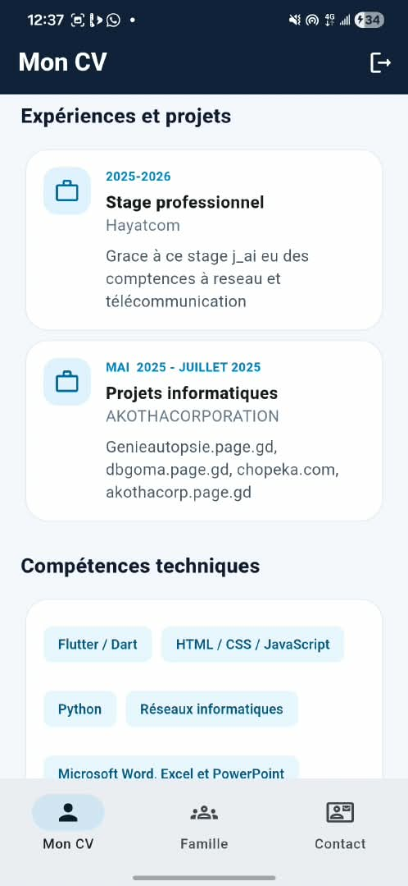
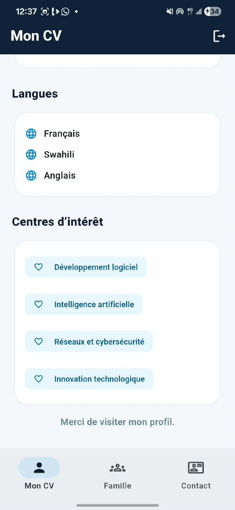
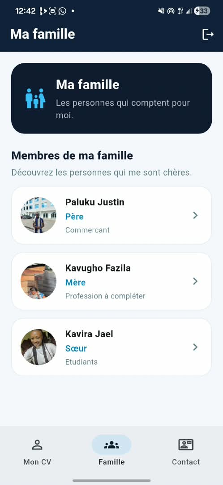

# CV Flutter - Joël Kambale

Application mobile développée avec Flutter et Dart.

## Présentation

Cette application permet de découvrir mon parcours académique,
mes expériences, mes compétences, ma famille et mes coordonnées.

## Fonctionnalités

- Page de connexion locale
- Présentation du CV
- Présentation de la famille
- Coordonnées personnelles
- Navigation entre les pages
- Déconnexion

## Technologies

- Flutter
- Dart
- Material Design 3
- Git
- GitHub

## Authentification

Identifiant : Joel

Mot de passe : 123456

## Auteur

Kambale Kyatsinge Joel

## Capture Application

## video domo

